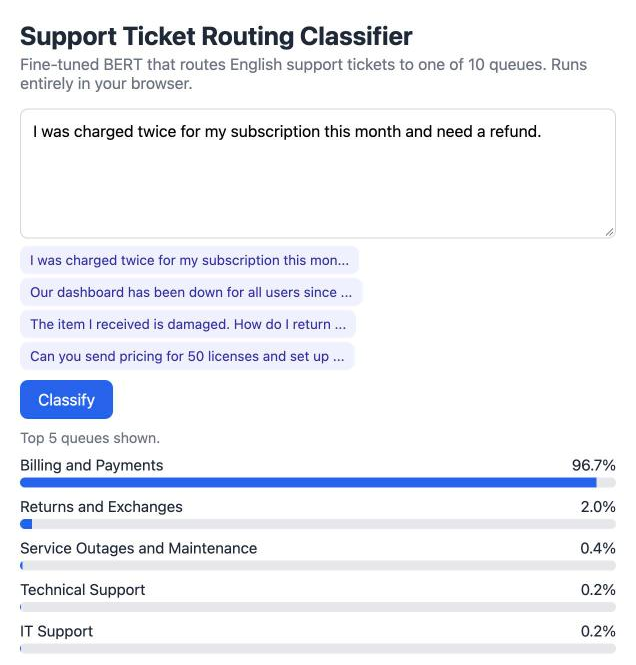
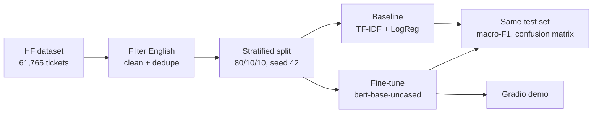
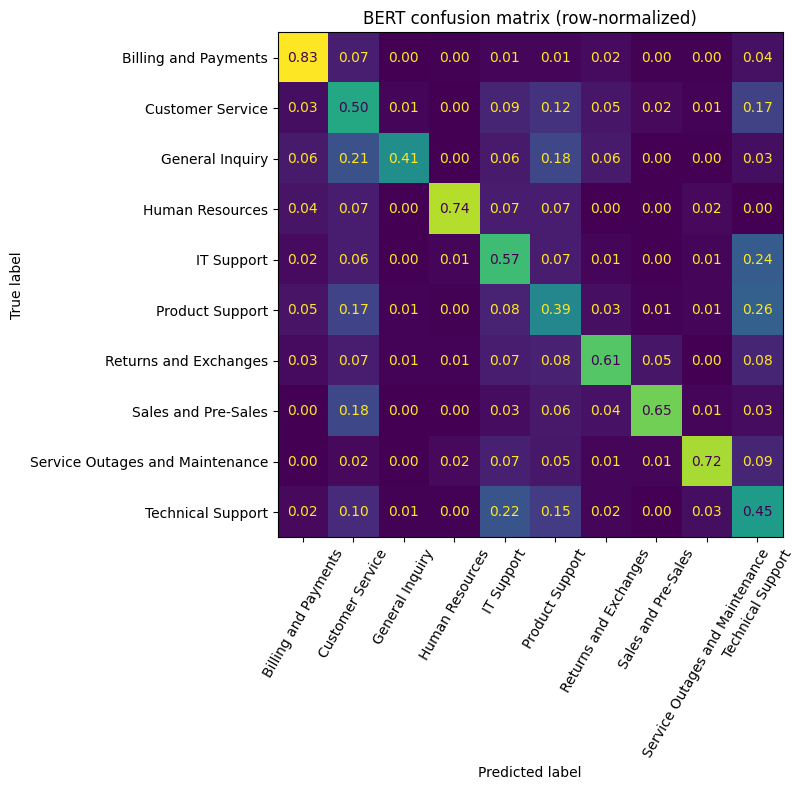

# Support Ticket Routing Classifier

Routes English customer support tickets to the right team (one of 10 queues) using a fine-tuned **BERT** model, benchmarked against a **TF-IDF + logistic regression** baseline on the same held-out test set.

**Result:** fine-tuned BERT reached **0.565–0.579 macro-F1** across two training runs, against **0.507** for the baseline, with the largest gains on the smaller queues.

**Live demo:** [try it in your browser](https://huggingface.co/spaces/preshanth09/support-ticket-classifier-demo) · **Model:** [preshanth09/support-ticket-classifier](https://huggingface.co/preshanth09/support-ticket-classifier)



## Problem

Support teams lose time when tickets land in the wrong queue and have to be re-assigned by hand. This project predicts the destination queue from the ticket's subject and body and suggests the **top-3 queues** to the agent doing triage. At about 51–53% accuracy on unseen tickets, it is meant to speed up triage, not to route tickets without a human check.

## Data

- **Source:** [`Tobi-Bueck/customer-support-tickets`](https://huggingface.co/datasets/Tobi-Bueck/customer-support-tickets) on Hugging Face (synthetic tickets in English and German). No manual download is needed: `src/data.py` and the notebook load it with the `datasets` library.
- **Used:** English tickets only. Input text = subject + body. Removed empty or very short texts and exact duplicates.
- **After cleaning:** 23,745 tickets across 10 queues, with a median length of 60 words.
- **Split:** stratified 80 / 10 / 10 (18,996 train, 2,374 validation, 2,375 test), seed 42. Both models are scored on the same test set.

The classes are imbalanced: Technical Support has 6,857 tickets and General Inquiry has 342. That is why **macro-F1** (every queue counts equally) is the headline metric rather than accuracy.

| Queue | Tickets |
|---|---|
| Technical Support | 6,857 |
| Product Support | 4,430 |
| Customer Service | 3,570 |
| IT Support | 2,832 |
| Billing and Payments | 2,419 |
| Returns and Exchanges | 1,173 |
| Service Outages and Maintenance | 937 |
| Sales and Pre-Sales | 724 |
| Human Resources | 461 |
| General Inquiry | 342 |

## Approach



1. **Baseline:** TF-IDF on word unigrams and bigrams, logistic regression with `class_weight="balanced"`.
2. **BERT:** `bert-base-uncased` fine-tuned with the Hugging Face `Trainer`. Max length 256 tokens, learning rate 3e-5 with 700 warmup steps, batch size 16, 6 epochs, mixed precision on a Colab T4 GPU (about 19 minutes). The best epoch is chosen by validation macro-F1.
3. **Class-weighted loss:** the first BERT run used plain cross-entropy and scored only 0.399 macro-F1. It never predicted General Inquiry, and it was still improving when training stopped after 3 epochs. Adding inverse-frequency class weights (matching the baseline's balanced weighting) and training for 6 epochs fixed both problems.
4. **Reproducibility check:** the saved model is reloaded from disk and re-scored on the test set (macro-F1 0.58, matching the in-memory result).

## Results

Held-out test set, 2,375 tickets:

| Model | Accuracy | Macro-F1 | Weighted-F1 |
|---|---|---|---|
| TF-IDF + LogReg | 0.504 | 0.507 | 0.505 |
| **BERT (fine-tuned)** | **0.531** | **0.579** | **0.528** |

F1 by queue:

| Queue | Baseline | BERT |
|---|---|---|
| Billing and Payments | 0.748 | 0.799 |
| Human Resources | 0.590 | 0.731 |
| Service Outages and Maintenance | 0.574 | 0.687 |
| Sales and Pre-Sales | 0.447 | 0.676 |
| Returns and Exchanges | 0.452 | 0.578 |
| Technical Support | 0.523 | 0.492 |
| Customer Service | 0.443 | 0.480 |
| IT Support | 0.451 | 0.472 |
| General Inquiry | 0.406 | 0.452 |
| Product Support | 0.439 | 0.424 |



### Published model

The fine-tuned model is on Hugging Face: [preshanth09/support-ticket-classifier](https://huggingface.co/preshanth09/support-ticket-classifier). It comes from a second training run with identical settings and seed, which scored **0.565 macro-F1** (accuracy 0.514) on the same test set. GPU non-determinism causes about one point of variation between runs; the tables above are from the first run (0.579).

### What the errors show

- Queues with clear vocabulary (billing, HR, outages, sales) are separated well.
- BERT is **not better everywhere**: it scores slightly below the baseline on Technical Support (0.492 vs 0.523) and Product Support (0.424 vs 0.439), the two largest and most overlapping queues. Its gains come from the smaller, more distinctive queues, which is why macro-F1 improves while accuracy rises less.
- Most errors happen among **Technical Support, IT Support and Product Support**: 24% of IT Support and 26% of Product Support tickets are predicted as Technical Support. These queues describe overlapping problems, so the labels themselves are ambiguous. That overlap, not the model size, is the main ceiling on accuracy.
- For real routing, showing the **top-3 queues** to the triage agent is safer than auto-assigning the top prediction for those three queues.

## Run it

Tested with Python 3.13 (Google Colab, November 2026).

```bash
git clone https://github.com/im-preshanth/support-ticket-classifier.git
cd support-ticket-classifier
pip install -r requirements.txt

# Baseline (CPU, about a minute)
python -m src.baseline

# Fine-tuning: open notebooks/ticket_classifier.ipynb in Google Colab,
# select a T4 GPU, and run all cells. It saves the model to ticket_model.zip.

# Predict with the published model (downloaded from Hugging Face on first use, no training needed)
MODEL_ID=preshanth09/support-ticket-classifier python -m src.predict "I was charged twice for my subscription this month"

# Or with a model you trained yourself (unzip ticket_model.zip into ./model)
python -m src.predict "I was charged twice for my subscription this month"

# Local demo (uses the published model)
MODEL_ID=preshanth09/support-ticket-classifier python app/app.py
```

## Project structure

```
support-ticket-classifier/
├── notebooks/ticket_classifier.ipynb   # exploration, training, evaluation (with outputs)
├── src/
│   ├── data.py                         # loading, cleaning, stratified split
│   ├── baseline.py                     # TF-IDF + logistic regression
│   └── predict.py                      # inference with the fine-tuned model
├── app/app.py                          # Gradio demo
├── reports/
│   ├── confusion_matrix.png
│   └── results.csv
├── MODEL_CARD.md
├── LICENSE
└── requirements.txt
```

## Limitations

- The dataset is **synthetic**, so scores on real company tickets will differ. Retraining on in-house labelled tickets would be required before production use.
- English only (German tickets were excluded).
- Scores vary by about one macro-F1 point between training runs (0.579 and 0.565 in two runs with the same settings).

## Next steps

- Try `roberta-base` or `deberta-v3-base`, and average results over several seeds.
- Merge or redefine the overlapping Technical / IT / Product Support queues together with the support team.
- Add a confidence threshold that sends low-confidence tickets to manual triage.
- Track experiments with MLflow.

## Tech stack

Python · Hugging Face Transformers and Datasets · PyTorch · scikit-learn · pandas · matplotlib · Gradio · Google Colab (T4 GPU)
